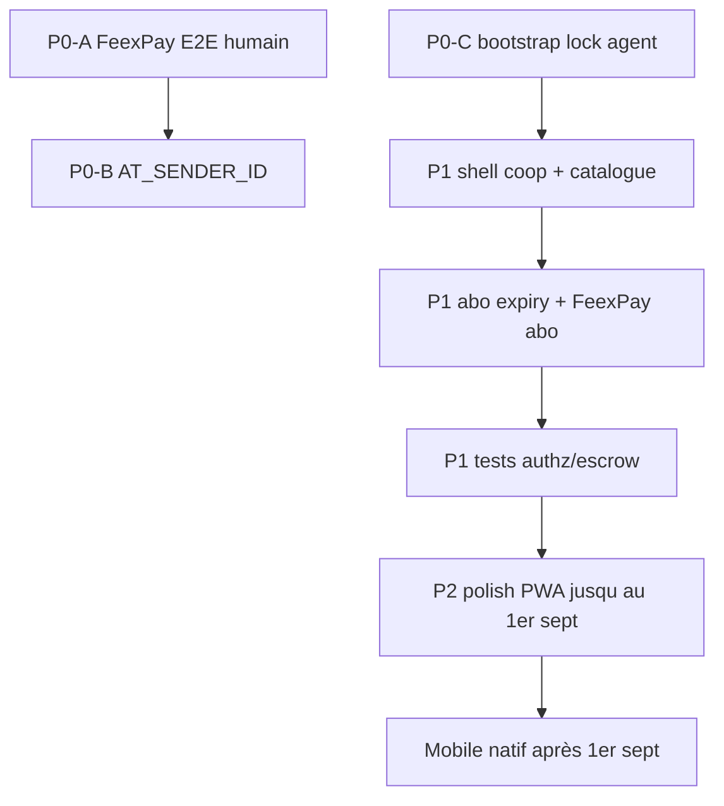

# Audit complet GWA — propositions d’amélioration (v2)

**Date :** 2026-08-03 (rév. post-`567a0d9`)  
**Périmètre :** PWA Next.js (`v0-gwa`) — auth, double identité, abo, backoffice, paiements/escrow, UX rôles, ops, sécu, tests.  
**Méthode :** revue code + schémas + docs (pas d’E2E prod FeexPay/SMS).  
**Contrainte produit :** **mobile natif après le 1er septembre 2026** — focus PWA jusque-là ([`roadmap-mobile-post-1er-septembre-2026.md`](./roadmap-mobile-post-1er-septembre-2026.md)).

---

## Verdict

GWA est **prêt pour démo / soft-launch technique** : double identité admin/métier, RBAC admin API, escrow qui ne « libère » plus si le payout échoue, checkout avec erreurs claires.  

Le **go-live monétisé** reste **bloqué par ops humains** : FeexPay E2E + `AT_SENDER_ID` (Africa’s Talking ≠ OneSignal).

| Domaine | Note | Évolution vs audit v1 |
|---------|------|------------------------|
| Auth & double identité | **A−** | Stable |
| Backoffice RBAC API | **B+** | ~~C+~~ → `requireAdminSection` partout |
| Paiements / escrow | **B** | ~~B−~~ → held si payout KO |
| Abonnements vendeur | **B** | File admin OK ; expiry + FeexPay abo encore ouverts |
| UX acheteur | **B+** | Confirm 1 tap livré |
| UX producteur | **B** | Fold encore dense |
| UX coopérative | **C+** | Toujours hors shell |
| A11y | **B−** | Acc-1 OK ; Acc-2/3 ouverts |
| Ops / go-live | **C** | Inchangé (secrets) |
| Tests | **B** | + CSRF / rôles ; manque matrix authz + webhook |

---

## Clarifications importantes

### OneSignal ≠ Africa’s Talking

| | Africa’s Talking | OneSignal |
|--|------------------|-----------|
| Canal | **SMS** | **Push** PWA / navigateur |
| Usage | OTP login | Alertes commande / digest |
| Doc | [`ops-auth.md`](./ops-auth.md) | [`ops-notifications.md`](./ops-notifications.md) |

Synthèse : [`onesignal-vs-africas-talking.md`](./onesignal-vs-africas-talking.md).

### Mobile natif

Pas avant le **1er septembre 2026**. D’ici là : PWA, FeexPay, SMS OTP, UX terrain.

---

## Ce qui est solide maintenant

1. **Double identité** — post-auth → espace métier ; backoffice via bandeau / profil / sidebar.
2. **RBAC admin API** — `requireAdminSection` / `requireAdminAction` ; rôles DB inconnus refusés.
3. **Colonnes privilégiées** — migration `056` (service_role seul) ; plus d’auto-élévation dual-identity.
4. **Escrow** — confirm acheteur : `held` si payout échoue ; retry possible.
5. **Checkout** — panier n’envoie plus vers « confirmation » si FeexPay down.
6. **Acheteur** — CTA « J’ai reçu » sur le home.
7. **Shell** — wallet / affacturage sans double `Navigation` ; middleware protège `/abonnement`, `/scg`, `/affacturage`.
8. **Pricing** — Free / Starter / Pro / Entreprise + commissions cohérents.

---

## Findings encore ouverts

### Ops (humain — P0 go-live)

| ID | Finding | Action |
|----|---------|--------|
| **O1** | FeexPay non E2E en prod | `FEEXPAY_API_KEY` + `SHOP_ID` + webhook → parcours pay→held→confirm→payout |
| **O2** | SMS OTP fragile | `AT_SENDER_ID` approuvé CI → `sms_delivery_ready` |
| **O3** | Contenu démo faible | Seed 1 coop + 15–20 produits + commande guidée |
| **O4** | Clé CSRF interne | Définir `GWA_INTERNAL_KEY` (ou s’appuyer sur `CRON_SECRET`) |

### Code / produit (agent possible)

| ID | Sévérité | Finding | Preuve |
|----|----------|---------|--------|
| **S9** | P0 | Bootstrap premier admin : race check-then-insert | `app/api/admin/bootstrap/route.ts` |
| **S10** | P1 | Abo sans `subscription_expires_at` / downgrade | activate + schémas |
| **S11** | P1 | Abo vendeur encore WhatsApp + file admin | `app/abonnement/page.tsx` |
| **S12** | P1 | `/cooperatives*` hors shell + `Navigation` locale | `lib/navigation/shell-routes.ts`, pages coop |
| **S13** | P1 | PII résiduelle (chat / factures phone) | à durcir selon `037` live |
| **S14** | P2 | `typescript.ignoreBuildErrors: true` | `next.config.mjs` |
| **S15** | P2 | Fold producteur dense | `app/dashboard/farmer/page.tsx` |
| **S16** | P2 | Offline publish = texte seul (pas de photos) | `lib/offline/publish-queue.ts` |
| **S17** | P2 | Tests : pas de matrix authz admin / webhook FeexPay / confirm payout-fail | `tests/` |
| **S18** | P2 | Inventory routes : pay marqué partial **et** complete | `lib/routes/inventory.ts` |

### Findings v1 **corrigés** (ne plus traiter)

| Ancien | Statut |
|--------|--------|
| S1 RBAC API incomplet | **Corrigé** (`requireAdminSection`) |
| S2 Auto-tier / verify admin JWT | **Corrigé** (`056`) |
| S3 Rôle inconnu → admin | **Corrigé** |
| S4 Escrow released si payout fail | **Corrigé** |
| S5 CSRF clé non vérifiée | **Corrigé** |
| S8 wallet double nav + middleware abo | **Corrigé** (partiel : coop reste) |

---

## Propositions priorisées

### P0 — Go-live (ops + 1 fix code)

| ID | Proposition | Qui | Impact |
|----|-------------|-----|--------|
| **P0-A** | Brancher FeexPay + E2E escrow | Humain | Argent réel |
| **P0-B** | `AT_SENDER_ID` Africa’s Talking | Humain | OTP terrain |
| **P0-C** | Durcir bootstrap (lock / contrainte unique premier admin) | Agent | Évite 2 super_admin |
| **P0-D** | UX erreur + WhatsApp si pay down | Déjà fait | — |

### P1 — Rétention & confiance

| ID | Proposition | Qui | Impact |
|----|-------------|-----|--------|
| **P1-A** | Shell coop (`/cooperatives*` + retirer nav locale) | Agent | Une seule app |
| **P1-B** | Catalogue membres `/dashboard/cooperative/catalogue` | Agent | Rôle coop utile |
| **P1-C** | `subscription_expires_at` + job downgrade Free | Agent | Abo = revenu |
| **P1-D** | Payer l’abo via FeexPay (fin WhatsApp-only) | Agent + ops | Conversion |
| **P1-E** | File retry payout admin (held + failed) | Agent | Ops escrow |
| **P1-F** | Tests authz matrix + confirm payout-fail + webhook HMAC | Agent | Régression |
| **P1-G** | Seed soft-launch | Humain | Démos |

### P2 — Polish PWA (avant mobile natif)

| ID | Proposition | Impact |
|----|-------------|--------|
| **P2-A** | Alléger fold producteur (UI-2 suite) | Clarté |
| **P2-B** | Outbox photos offline | Terrain |
| **P2-C** | Acc-2/3 a11y (contraste, glossaire, SR) | Inclusion |
| **P2-D** | Timeline escrow O1–O6 | Confiance |
| **P2-E** | Widget `/api/health` sur `/admin` | Visibilité ops |
| **P2-F** | Couper `ignoreBuildErrors` | Qualité CI |
| **P2-G** | Hygiene inventory + docs | Moins de fausse confiance |
| **P2-H** | Mode ops masquable (dual-identity) | Moins d’actions accidentelles |

---

## Par persona

### Producteur
OK : espace, abo file, wallet sans double chrome.  
Manque : fold dense, photos offline, abo auto FeexPay.

### Acheteur
OK : confirm 1 tap, erreurs paiement claires.  
Bloqué : FeexPay live.

### Coopérative
Fragile : hors shell, pas de catalogue membres, create partiel.

### Admin double identité
OK : séparation login / bandeau / profil ; plus d’auto-privilège profil.  
Charge : abo manuel + payouts failed à traiter (file à renforcer).

---

## Plan technique suggéré

---

## Liens

| Doc | Rôle |
|-----|------|
| [`etat-des-lieux-prochaines-etapes.md`](./etat-des-lieux-prochaines-etapes.md) | État terrain |
| [`ops-go-live.md`](./ops-go-live.md) | GO/NO-GO |
| [`onesignal-vs-africas-talking.md`](./onesignal-vs-africas-talking.md) | SMS vs push |
| [`roadmap-mobile-post-1er-septembre-2026.md`](./roadmap-mobile-post-1er-septembre-2026.md) | Mobile après 1er sept |
| [`audit-complet-propositions-2026-08-03.md`](./audit-complet-propositions-2026-08-03.md) | Audit v1 (historique + suivi correctifs) |

---

*Prochaine revue audit : après FeexPay E2E ou avant kickoff mobile (sept. 2026).*
