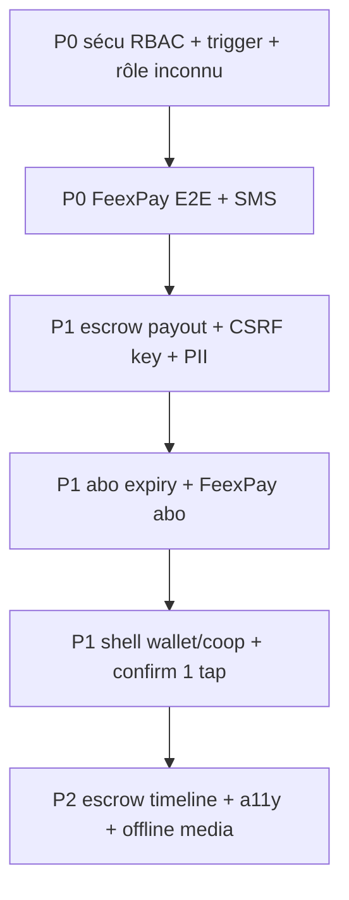

**Date :** 2026-08-03  
**Statut :** **historique** — remplacé par [`audit-complet-propositions-2026-08-03-v2.md`](./audit-complet-propositions-2026-08-03-v2.md) (état post-`567a0d9`).

# Audit complet GWA — propositions d’amélioration

---

## Verdict

GWA est **crédible en démo** : rôles métier séparés du backoffice, shell mobile/desktop, Yelly, abo vendeur manuel, escrow applicatif FeexPay.  
Le **go-live monétisé** reste bloqué surtout par **ops externes** (FeexPay E2E, SMS `AT_SENDER_ID`) et par **quelques trous sécu admin / PII / escrow payout**.

| Domaine | Note | Commentaire |
|---------|------|-------------|
| Auth & double identité | **B+** | Login → espace métier si `user_type` ; backoffice via bandeau / profil |
| Abonnements vendeur | **B** | File admin + activation manuelle OK ; pas d’expiry ni paiement abo en ligne |
| Backoffice RBAC | **C+** | Matrice rôles côté UI ; **APIs souvent `requireAdmin` seul** |
| Paiements / escrow | **B−** | Webhook HMAC solide ; release même si payout échoue |
| UX producteur / acheteur | **B** | Homes utiles ; wallet double nav ; confirm acheteur encore 2 taps |
| UX coopérative | **C** | Dashboard partiel ; `/cooperatives*` hors shell |
| A11y | **B−** | Acc-1 livré ; Acc-2/3 ouverts |
| Ops / go-live | **C** | Checklist rouge FeexPay / SMS / seed |
| Tests | **B−** | ~193 vitest ; peu d’authz API / webhook / escrow fail |

---

## Ce qui fonctionne bien

1. **Double identité** — `lib/auth/dual-identity.ts`, `lib/auth/post-auth.ts`, bandeau `AdminModeBanner`, profil en blocs « Compte GWA » / « Backoffice », sidebar admin → espace métier.
2. **Pricing & entitlements** — Free / Starter / Pro / Entreprise + commissions 8 / 6.5 / 5 % cohérents (`lib/pricing/*`).
3. **File abonnements admin** — recherche, filtres, activation téléphone (`app/admin/subscriptions`).
4. **FeexPay** — client `server-only`, webhook signature + montant + idempotence.
5. **Baseline sécu** — CSRF same-origin, rate limits OTP/paiement, headers CSP, triggers téléphone / colonnes privilégiées (sauf bypass admin — voir P0).
6. **Shell** — bottom nav + top nav alignés sur les parcours courants ; skip link, reduced motion, aide.

---

## Findings critiques (détail)

### S1 — RBAC admin incomplet côté API (P0)

`canAccessSection` / `requireAdminAction` ne sont appliqués de façon fiable que sur **subscriptions** et **support**.  
Finances, users, products, orders, disputes, verifications, stats, SCG, AI : souvent `requireAdmin()` seul → un **moderator** peut appeler des routes hors de sa matrice UI.

**Fichiers :** `lib/auth/admin-permissions.ts`, `app/api/admin/**` (sauf subscriptions/support).

### S2 — Admin peut s’auto-attribuer tier / vérif (P0)

Trigger `protect_profile_privileged_columns` (`049`) : si `admin_roles` actif → `RETURN NEW` sans filtrer les colonnes.  
Avec RLS `profiles_update_own`, un compte **double identité** peut PATCH son propre `subscription_tier` / `is_verified` via le client.

### S3 — Rôle DB inconnu → promu `admin` (P0)

```46:46:lib/auth/require-admin.ts
  const adminRole = isAdminRole(role.role) ? role.role : ("admin" as AdminRole)
```

### S4 — Escrow `released` même si payout échoue (P1)

`app/api/orders/[id]/confirm/route.ts` marque `escrow_status: "released"` alors que `payoutStatus` peut être `"failed"` → risque comptable / double payout en retry.

### S5 — CSRF : header `x-gwa-internal-key` non vérifié (P1)

Présence du header suffit à bypasser CSRF (`lib/security/csrf.ts`) — la valeur n’est pas comparée à un secret.

### S6 — PII profils lisibles entre utilisateurs connectés (P1)

Politiques historiques : `authenticated` peut SELECT des colonnes sensibles (email/phone) sur d’autres profils.

### S7 — Abo sans date d’expiration (P1)

Activation = set `subscription_tier` ; pas de `subscription_expires_at` / cron de downgrade.

### S8 — UX / ops (P1–P2)

- Wallet / affacturage remountent une 2ᵉ `Navigation` (double chrome).
- Coop hors shell ; catalogue membres manquant.
- Abo vendeur encore WhatsApp + ops manuelle.
- `/abonnement` pas dans la liste middleware auth (guard client seulement).
- `typescript.ignoreBuildErrors: true` dans `next.config.mjs`.

---

## Propositions priorisées

### P0 — Sécurité & argent (faire avant go-live monétisé)

| ID | Proposition | Impact | Effort |
|----|-------------|--------|--------|
| **P0-1** | Helper `requireAdminSection(section)` / `requireAdminAction` sur **toutes** les routes `/api/admin/*` ; deny by default | Ferme le bypass RBAC | Moyen |
| **P0-2** | Trigger privilégié : **seul `service_role`** (ou super_admin via service) peut écrire tier / verify / suspend ; dual-identity ne s’auto-élève plus | Ferme auto-privilège | Moyen + migration |
| **P0-3** | Refuser rôle `admin_roles` inconnu (non-admin) au lieu de forcer `"admin"` | Évite escalation | Faible |
| **P0-4** | Brancher FeexPay prod + webhook + E2E pay→held→confirm→payout | Débloque escrow réel | Ops |
| **P0-5** | `AT_SENDER_ID` → OTP SMS fiable CI | Onboarding terrain | Ops |
| **P0-6** | UX erreur checkout claire si FeexPay down (FR + WhatsApp, pas d’échec silencieux) | Moins de paniers abandonnés / support | Faible |

### P1 — Confiance produit & rétention

| ID | Proposition | Impact | Effort |
|----|-------------|--------|--------|
| **P1-1** | Confirm réception : ne passer en `released` qu’après payout OK ; sinon `release_pending` + file retry admin | Intégrité fonds | Moyen |
| **P1-2** | Valider `x-gwa-internal-key` contre secret env (ou supprimer l’exemption) | CSRF solide | Faible |
| **P1-3** | Restreindre SELECT email/phone profils (vue publique / grants) | RGPD / confiance | Moyen + migration |
| **P1-4** | `subscription_expires_at` + job mensuel (downgrade Free) | Abo = vrai revenu récurrent | Moyen |
| **P1-5** | Payer l’abo via FeexPay (fin WhatsApp-only) + statut « en attente » dashboard | Conversion + moins d’ops | Moyen |
| **P1-6** | Retirer `Navigation` dupliquée wallet/affacturage ; `/cooperatives*` dans le shell | Une seule app | Faible |
| **P1-7** | Acheteur : confirm 1 tap depuis « À faire » home | Boucle escrow complète | Faible |
| **P1-8** | Coop : checklist qualification visuelle + `/dashboard/cooperative/catalogue` | Rôle coop utile | Moyen |
| **P1-9** | Seed soft-launch (1 coop, 15–20 produits, parcours guidé) | Démos / formation | Ops |
| **P1-10** | Tests : matrix authz admin, post-auth dual, webhook FeexPay, confirm payout fail | Régression sécu | Moyen |

### P2 — Polish, a11y, croissance

| ID | Proposition | Impact | Effort |
|----|-------------|--------|--------|
| **P2-1** | Timeline escrow O1–O6 + motifs litige (v3) | Confiance UX | Moyen |
| **P2-2** | Acc-2/3 : contraste élevé, glossaire, announce SR, Playwright smoke | Inclusion | Moyen |
| **P2-3** | Outbox médias offline (photos publish) | Terrain réel | Moyen |
| **P2-4** | Widget santé `/api/health` sur dashboard admin | Visibilité ops | Faible |
| **P2-5** | Mode ops optionnel (bandeau admin masquable) pour dual-identity | Moins d’actions métier accidentelles | Faible |
| **P2-6** | Désactiver `ignoreBuildErrors` une fois le typage propre | Qualité CI | Moyen |
| **P2-7** | `/abonnement` (+ `/scg`) dans middleware auth | Cohérence garde | Faible |
| **P2-8** | Aligner docs (UI-1 « done », inventory pay/coop, etat-des-lieux vs go-live) | Moins de fausse confiance | Faible |
| **P2-9** | Décision datée CinetPay (POC dual ou report) | Stratégie paiement | Décision |
| **P2-10** | Data-saver + prefetch PDP | Perf 3G | Faible |

---

## Par persona — frictions → correctifs

### Producteur
- Fold dashboard encore dense → alléger (UI-2 suite).  
- Abo WhatsApp → **P1-5**.  
- Offline sans photo → **P2-3**.

### Acheteur
- Paiement fragile sans FeexPay → **P0-4 / P0-6**.  
- Confirm trop loin → **P1-7**.  
- Recherche « bientôt » → copy / empty states utiles.

### Coopérative
- Dashboard / create partiels ; hors shell → **P1-6 / P1-8**.  
- Tab « Publier » (seller) peut surprendre un gérant → libellé « Catalogue » pour coop.

### Admin double identité (votre cas)
- Séparation login / bandeau / profil **OK**.  
- Risque restant : auto-privilège profil → **P0-2**.  
- Charge ops abo manuelle → **P1-5** + file actuelle déjà améliorée.

---

## Ops GO / NO-GO (rappel)

| Critère | Statut typique | Action |
|---------|----------------|--------|
| FeexPay clés + webhook E2E | ⛔ | P0-4 |
| SMS `AT_SENDER_ID` | ⛔ / ⚠ | P0-5 |
| HIBP Auth | checklist | Activer |
| Migrations `scripts/schema/` (pas auto GitHub) | ⚠ | Process manuel ; ne pas activer Deploy GitHub sans `supabase/migrations/` |
| Seed contenu | faible | P1-9 |
| OneSignal prod | partiel | Smoke push commande |

Détail : `docs/ops-go-live.md`, `docs/etat-des-lieux-prochaines-etapes.md`.

---

## Plan d’exécution suggéré (technique, sans calendrier)



1. **Couche sécu API/DB** (P0-1…3) — agent + migration.  
2. **Ops argent/OTP** (P0-4…5) — humain / secrets.  
3. **Intégrité escrow + abo durable** (P1-1…5).  
4. **UX shell / personas** (P1-6…8).  
5. **Polish** (P2).

---

## Liens docs liés

| Doc | Relation |
|-----|----------|
| [`etat-des-lieux-prochaines-etapes.md`](./etat-des-lieux-prochaines-etapes.md) | État terrain + next steps |
| [`ops-go-live.md`](./ops-go-live.md) | Checklist GO/NO-GO |
| [`security.md`](./security.md) | Synthèse sécu (à aligner avec findings S1–S6) |
| [`propositions-autonomes-v3.md`](./propositions-autonomes-v3.md) | Escrow UX, PWA, croissance |
| [`propositions-accessibilite-facilite-v4.md`](./propositions-accessibilite-facilite-v4.md) | Acc-2/3 |
| [`propositions-ui-ux-dashboards.md`](./propositions-ui-ux-dashboards.md) | Homes rôles (partiellement livré) |

---

## Hors scope de cet audit

- Chiffres business / CAC / LTV.  
- Négociation FeexPay / banque.  
- Refonte design system complète.  
- Migration massive hors agriculture (scope beta).

---

*Document vivant : mettre à jour la colonne « Statut » des propositions au fur et à mesure des livraisons.*

---

## Suivi corrections (2026-08-03, agent autonome)

| ID | Statut | Notes |
|----|--------|-------|
| P0-1 RBAC API | **Fait (code)** | `requireAdminSection` sur routes admin |
| P0-2 Trigger privilégié | **Fait (appliqué prod)** | `056` via Supabase + `scripts/schema/056_…sql` |
| P0-3 Rôle inconnu | **Fait** | `requireAdmin` refuse |
| P0-4 FeexPay E2E | **Bloqué ops** | Secrets Vercel |
| P0-5 AT_SENDER_ID | **Bloqué ops** | Africa’s Talking (≠ OneSignal) |
| P0-6 Checkout erreur | **Fait** | Panier ne confirme plus si pay échoue |
| P1-1 Escrow payout fail | **Fait** | Escrow reste `held` si payout KO |
| P1-2 CSRF internal key | **Fait** | Clé vérifiée vs env |
| P1-6 Double Navigation | **Fait** | Wallet / affacturage |
| P1-7 Confirm 1 tap | **Fait** | Home acheteur |
| Middleware abo/scg | **Fait** | |
| Docs OneSignal vs AT | **Fait** | `onesignal-vs-africas-talking.md` |
| Mobile natif | **Reporté** | Après **1er sept 2026** — `roadmap-mobile-post-1er-septembre-2026.md` |
